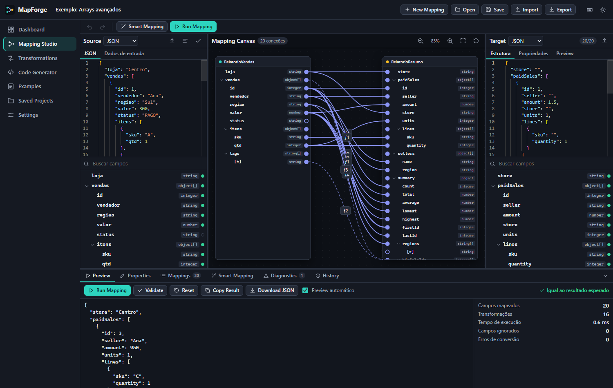
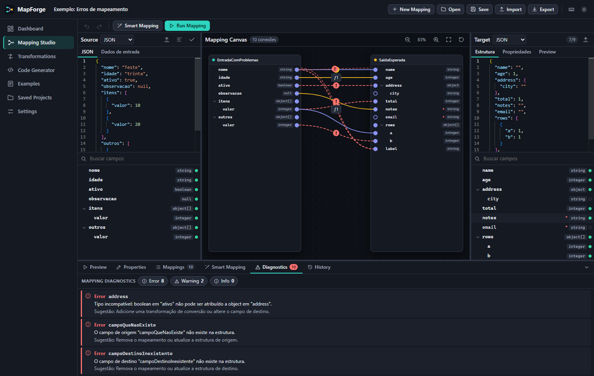
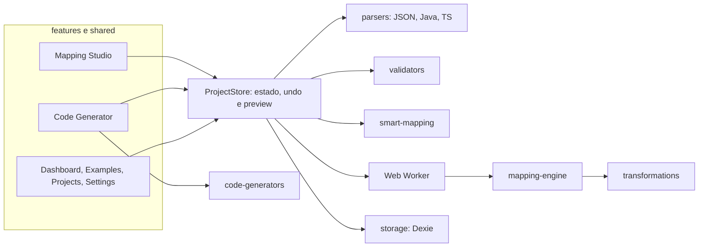

# MapForge — Visual Data Mapping Studio

Importe estruturas de dados, conecte os campos visualmente, aplique transformações, execute o mapeamento e gere código Java e TypeScript. Tudo roda no navegador: nenhum JSON ou código sai da sua máquina.



| Diagnósticos | Tema claro |
| --- | --- |
|  |  |

## Objetivo

Escrever mappers entre APIs, DTOs e ViewModels é repetitivo e sujeito a erros silenciosos. O MapForge permite desenhar o mapeamento, ver o resultado real a cada alteração e levar para o projeto um código equivalente, compilável e sem dependência do MapForge.

O código gerado é verificado: os testes compilam o TypeScript em modo `strict`, compilam o Java com `javac` e o MapStruct com o processador real, executam tudo e comparam o resultado com o do motor.

## Início rápido

Pré-requisitos: Node.js 22.22, 24.15 ou mais recente, e npm.

```bash
npm install
npm start
```

Abra <http://localhost:4200>, vá em **Examples** e clique em **Abrir e executar** em qualquer exemplo.

| Comando | O que faz |
| --- | --- |
| `npm start` | Servidor de desenvolvimento |
| `npm run build` | Build de produção em `dist/mapforge/browser` |
| `npm test` | Testes do núcleo e dos componentes |
| `npm run test:core` | Regras de negócio e equivalência (Vitest, em Node) |
| `npm run test:ui` | Componentes Angular (`ng test`) |
| `npm run test:e2e` | Build de produção e testes Playwright |
| `npm run format` | Prettier |

O build gera um site estático: publique `dist/mapforge/browser` em qualquer servidor, redirecionando as rotas desconhecidas para `index.html`.

**Sobre os testes de Java:** os testes de equivalência em Java exigem `javac` no `PATH` e são ignorados sem ele. Os de MapStruct baixam os jars do Maven Central na primeira execução, guardam em `tests/equivalence/.java-cache` e são ignorados se não houver rede. O aplicativo em si não usa rede nem Java. Os testes E2E usam o Chromium do Playwright: se necessário, rode `npx playwright install chromium`.

## Funcionalidades

- **Mapping Studio:** painéis Source e Target com editor Monaco e canvas com conexões SVG, com zoom, pan, Fit to Screen e Reset View. As linhas são medidas a partir da posição real dos campos e acompanham scroll, zoom, expansão e recolhimento.
- **52 transformações** em strings, números, datas, booleanos, utilitários e arrays. Cada uma tem formulário e prévia, e cada etapa mostra entrada e saída.
- **Smart Mapping** por regras determinísticas e explicáveis, com sinônimos português e inglês configuráveis. Nada é aplicado sem aceite, e sugestões ambíguas nunca entram na aceitação em lote.
- **Arrays:** caminhos como `pedidos[*].codigo`, arrays aninhados, escopos de linha (filtro, ordenação, distinct) e agregações, sem misturar elementos de posições diferentes.
- **Importação** de JSON, classes Java (`.java`) e interfaces TypeScript (`.ts`) por parsers próprios. O que não é suportado gera erro ou aviso explícito.
- **Code Generator:** Java puro, MapStruct, TypeScript, Angular Service, classes Java DTO e interfaces TypeScript.
- **Mapping Diagnostics:** erros, avisos e informações, sempre com campo afetado, causa e sugestão. O clique destaca a conexão.
- **Preview em tempo real** em Web Worker, com debounce e tempo limite, mais histórico local de execuções.
- **Projetos** em IndexedDB: criar, renomear, duplicar, favoritar, buscar, excluir, importar e exportar.
- **Experiência de uso:** undo/redo, atalhos de teclado (tecla `?`), tema escuro e claro, layout adaptável e conexão de campos pelo teclado.

## Como criar um mapeamento

1. Clique em **New Mapping**.
2. No painel **Source**, escolha o formato e cole a estrutura ou importe um arquivo. Em Java e TypeScript, use a aba **Dados de entrada** e **Gerar da estrutura** para ter dados de execução.
3. Faça o mesmo no painel **Target**. Na aba **Propriedades**, defina tipos e campos obrigatórios.
4. No canvas, arraste do ponto de um campo de origem até o ponto de um campo de destino. Outra forma é clicar em um ponto e depois no outro, ou usar `Enter` pelo teclado.
5. Para receber sugestões, clique em **Smart Mapping**, aceite ou rejeite cada uma.
6. Confira o resultado na aba **Preview** e os problemas em **Diagnostics**. Salve com `Ctrl + S`.

### Listas

| Origem | Destino | Efeito |
| --- | --- | --- |
| `pedidos[*].codigo` | `orders[*].id` | Uma linha de destino por item de origem |
| `pedidos[*].itens[*].sku` | `orders[*].items[*].code` | Listas aninhadas, dentro do pedido correto |
| `pedidos[*].valor` + **Sum** | `total` | Agregação de toda a lista |
| `pedidos[*].itens[*].qtd` + **Sum** | `orders[*].units` | Agregação por pedido |
| `moeda` | `orders[*].currency` | Copia o valor do pai para cada linha já criada |

Para filtrar, ordenar ou remover repetições **sem desalinhar os campos da linha**, selecione uma conexão do array e use a seção **Linhas de** em **Properties**.

## Como usar transformações

Selecione uma conexão e abra **Properties**. Em **Adicionar…**, escolha a transformação e configure. As etapas rodam em ordem, podem ser reordenadas ou desativadas, e cada uma mostra a entrada e a saída da primeira linha processada.

Para conhecer o catálogo e testar valores sem criar um mapeamento, use a tela **Transformations**.

Valor inválido, como `"abc"` em String to Number, registra um erro de conversão, resulta em `null` e não interrompe os demais campos. A semântica completa está em [docs/mapping-engine.md](docs/mapping-engine.md).

## Como gerar código

Na tela **Code Generator**, escolha o tipo, o nome e o package Java. A prévia é atualizada a cada mudança, com **Copy** e **Download** por arquivo.

| Tipo | Saída |
| --- | --- |
| Java puro | Classe mapper sem dependências e, para estruturas que não vieram de Java, as classes DTO |
| Java com MapStruct | Interface `@Mapper`, classe de funções auxiliares e DTOs |
| TypeScript | Interfaces e função tipada |
| Angular Service | O mesmo, mais um `@Injectable` com `map` e `mapList` |
| Classes Java DTO | Classes com campos, getters e setters |
| Interfaces TypeScript | Interfaces das duas estruturas |

O que não pode ser representado aparece em um aviso na tela e como comentário no código, sem gerar código enganoso. Em Spring Boot, adicione `componentModel = "spring"` à anotação `@Mapper`.

## Exemplos

| # | Exemplo | Demonstra |
| --- | --- | --- |
| 1 | Cliente | `ClienteDTO` em português para `CustomerDTO` em inglês |
| 2 | Pedido | Listas de itens, valores monetários e valor do pai em cada item |
| 3 | Pagamento | Enum Mapping, fuso horário, valor padrão e Lookup Table |
| 4 | API Legada | Registro plano para estrutura moderna, Coalesce e Split |
| 5 | Java DTO para Java DTO | Parser Java e mapper MapStruct |
| 6 | API REST para Frontend | ViewModel descrito por interface TypeScript e Angular Service |
| 7 | Arrays avançados | Filter, Sort, Distinct e todas as agregações |
| 8 | Erros de mapeamento | Tipos incompatíveis, campos ausentes e diagnósticos |

Os exemplos 1 a 7 mostram na aba Preview se o resultado é igual ao esperado.

## Tecnologias

| Área | Escolha |
| --- | --- |
| Framework | Angular 22, standalone components, Signals, zoneless |
| Linguagem | TypeScript 6 em modo `strict`, com `strictTemplates` |
| Editores | Monaco Editor, servido pelo próprio site |
| Componentes | Angular CDK: drag and drop, overlay e foco em diálogos |
| Persistência | IndexedDB com Dexie |
| Conexões visuais | Implementação SVG própria |
| Formatação | Prettier, carregado sob demanda para o TypeScript gerado |
| Testes | Vitest, Playwright e, como dev, `fake-indexeddb` |

## Arquitetura

As regras de negócio em `core/` não dependem de componentes: o motor, os parsers, os diagnósticos e os geradores são funções testadas em Node puro. Os componentes só leem sinais e chamam ações do `ProjectStore`.



```text
src/app/
  core/
    models/            Tipos: campos, mapeamentos, projeto, execução
    mapping-engine/    Caminhos, pipeline, motor e Web Worker
    transformations/   Catálogo, datas e comparações
    parsers/           Tokenizador, JSON, Java e TypeScript
    smart-mapping/     Regras de sugestão e sinônimos
    validators/        Compatibilidade de tipos e diagnósticos
    code-generators/   Plano, geradores e runtimes em templates/
    storage/           Repositório Dexie e formato de arquivo
    examples/          Os oito exemplos
    services/          ProjectStore, execução, preferências e avisos
  features/
    dashboard/  mapping-studio/  transformations/  code-generator/
    diagnostics/  examples/  saved-projects/  settings/
  shared/              Componentes e diretivas reutilizáveis
tests/
  equivalence/         Motor x código gerado, com tsc, javac e MapStruct
  e2e/                 Fluxos principais com Playwright
docs/
  mapping-engine.md    Sintaxe de caminhos e semântica do motor
  file-formats.md      Importação e arquivo de projeto
```

Duas decisões merecem nota:

- **O canvas tem cartões próprios**, em vez de ligar os painéis laterais. É isso que dá sentido a zoom e pan. Os painéis e os cartões compartilham o estado de expansão e a busca.
- **Filtro, ordenação e distinct de uma lista ficam no escopo do par de arrays**, e não em cada campo. O motor decide as posições uma vez, e todos os campos leem do mesmo item.

## Segurança e privacidade

- Sem backend, sem telemetria e sem CDN. O CSP limita `connect-src` à própria origem, e os testes E2E falham se houver qualquer requisição externa.
- O código e os arquivos importados são tratados como dados: são interpretados por parsers próprios e nunca executados. Não há `eval` nem `new Function` no aplicativo; os únicos usos ficam nos testes, para rodar o código gerado.
- Conteúdo é exibido por interpolação do Angular, sem `innerHTML`.
- Caminhos com `__proto__`, `constructor` e `prototype` são rejeitados.
- Arquivos são validados, e os limites de tamanho e profundidade são configuráveis em **Settings**.
- O motor roda em um Web Worker com tempo limite, de modo que uma regex lenta é interrompida sem travar a tela.
- O histórico de execuções guarda só contagens e tempos, nunca os dados.

## Testes

| Suíte | Testes | Cobre |
| --- | --- | --- |
| `npm run test:core` | 387 | Caminhos, motor, arrays, nulos, transformações, parsers, Smart Mapping, diagnósticos, persistência, importação e exportação, exemplos e equivalência dos geradores |
| `npm run test:ui` | 23 | Shell, `ProjectStore`, árvore de campos e funções de interface |
| `npm run test:e2e` | 43 | Rotas, oito exemplos, conexões por arrasto e teclado, alinhamento das linhas, undo, importação, geradores, persistência e worker |

## Limitações conhecidas

**Parsers**

- O parser Java reconhece a estrutura de declarações, sem compilar nem validar semântica. Campos cujo tipo não está no texto colado aparecem sem filhos e com aviso. `Map` e parâmetros genéricos viram `any`. Interfaces Java não geram campos.
- O parser TypeScript cobre o subconjunto de dados. Tuplas, intersections, tipos utilitários e genéricos viram `any` com aviso.
- Em JSON, os tipos vêm do exemplo fornecido. Um campo que só aparece como `null` tem tipo desconhecido, e são analisados os primeiros 500 itens de cada array.

**Código Java gerado**

- Requer Java 17 ou mais recente e DTOs JavaBean, com getters e setters escritos ou via Lombok. Records precisam de ajuste manual e geram aviso. A verificação automatizada foi feita em JDK 25 e MapStruct 1.6.3.
- Em POJO, nulo e ausente são indistinguíveis, e um objeto aninhado sem valores fica vazio em vez de ausente. Os testes de equivalência em Java tratam esses casos como iguais.
- As transformações numéricas usam `double`, como o motor. Copiar um `BigDecimal` sem transformação preserva a precisão, mas uma etapa aritmética pode perdê-la.
- O código gerado devolve `null` em falhas de conversão, mas não registra o erro como o motor faz. `Null Handling` em modo erro também resulta em `null`.
- Número acima de 1e15 convertido em texto usa a notação de cada linguagem, e expressões regulares seguem o dialeto de cada uma.
- Array na raiz não é gerado em Java. Copiar objeto entre classes diferentes exige mapear campo a campo. `Remove Empty Values` não entra em objetos POJO.
- **MapStruct:** copiar um valor do pai para as linhas de um array, listas de valores com transformação e arrays de arrays não têm equivalente. Viram `ignore = true`, comentário e aviso. Use o Java puro nesses casos.

**Motor e interface**

- Dois arrays de origem para o mesmo array de destino geram erro em Diagnostics. O motor combina por posição, e os geradores ignoram o segundo com aviso.
- O motor roda no worker, mas parsers, diagnósticos e a prévia da tela Transformations rodam na thread principal. Por isso existe o limite de tamanho, e uma regex lenta digitada nessa tela pode travar a aba.
- A árvore de campos não usa virtualização: estruturas com milhares de campos ficam lentas.
- Os dados ficam no navegador e no perfil atuais: limpar os dados do site apaga os projetos. Exporte o que for importante.
- Os arquivos do Code Generator são baixados um por vez.
- O build inclui cerca de 25 MB do Monaco como arquivos estáticos, carregados sob demanda.
- Os testes E2E rodam só no Chromium. A acessibilidade básica foi implementada (teclado, ARIA, foco, contraste nos dois temas), mas não houve auditoria formal nem teste com leitor de tela.

## Documentação técnica

- [Motor de mapeamento](docs/mapping-engine.md)
- [Formatos de importação e exportação](docs/file-formats.md)
